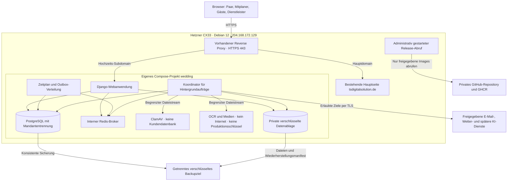

# Architekturplan für die Hochzeitsplattform

Stand: 23.10.2026. Grundlage: `blueprint.txt`, Version 1.0. Status: Architekturentwurf für die anschließende lokale Entwicklung.

Dieser Plan beschreibt die Anwendung, den Schutz der Kundendaten und den späteren Betrieb. Er enthält noch keine lauffähige Webseite oder fertige Serverkonfiguration. Die bestehende Hauptseite ist bei allen Betriebsentscheidungen zu berücksichtigen.

## 1. Festgelegte Rahmenbedingungen

| Punkt | Vorgabe |
|---|---|
| Lokales Projekt | `F:\Wedding` |
| Server | Vorhandener Hetzner CX33 |
| Betriebssystem | Debian 12 |
| Öffentliche IPv4-Adresse | `204.168.172.129` |
| Bestehende Hauptseite | `tsdigitalsolution.de` |
| Neue Adresse | Vorschlag: `hochzeit.tsdigitalsolution.de` |
| Betrieb | Eigener Docker-Compose-Stack neben der Hauptseite |
| Übertragung | Lokale Entwicklung, privates GitHub-Repository, geprüfte Container-Images, Abruf auf dem VPS |
| Wichtigste Anforderung | Schutz der Kundendaten, insbesondere zwischen verschiedenen Hochzeiten |

Hetzner führt den CX33 mit 4 vCPUs, 8 GB RAM und 80 GB NVMe-Speicher. Diese Ressourcen teilen sich die Hauptseite, das Betriebssystem und die Hochzeitsplattform. Die tatsächlich freie Kapazität wurde noch nicht auf dem Server gemessen. [Hetzner-Produktdaten](https://www.hetzner.com/cloud/cost-optimized/)

Debian 12 bleibt die geplante Hostbasis. Für Bookworm ist LTS bis zum 30.06.2028 vorgesehen. Der Betrieb muss die Paketabdeckung berücksichtigen und rechtzeitig ein Upgrade einplanen. Die offizielle Docker-Dokumentation unterstützt Debian 12. Dieser Plan sieht keine sofortige Änderung des Betriebssystems vor. [Debian-Lebenszyklus](https://www.debian.org/releases/bookworm/), [Docker auf Debian](https://docs.docker.com/engine/install/debian/)

Noch unbekannt sind der bestehende Webserver beziehungsweise Reverse Proxy, die Betriebsform der Hauptseite, belegte Ports, Firewallregeln, Speicherbelegung und Serverstandort. Diese Angaben werden vor der Servereinrichtung erhoben. Aus der IP-Adresse wird keine Datenschutzregion abgeleitet.

## 2. Architekturentscheidung

Die Plattform wird als modularer Monolith mit Django aufgebaut. Die Fachmodule verwenden dieselbe Anmeldung, Rechteprüfung und Datenbank. Aufwendige oder riskante Dateiverarbeitung läuft in getrennten Diensten.

Eine Hochzeit ist ein Mandant. Nutzer können mehreren Hochzeiten angehören, erhalten aber für jede Hochzeit eigene Rechte. Eine berechtigte Rolle in Hochzeit A erlaubt keinen Zugriff auf Hochzeit B.

Die Anwendung läuft in einem eigenen Container. Datenbank, Auftragsverarbeitung, Warteschlange und Dateiprüfung erhalten weitere Container. Ein einzelner Container für sämtliche Prozesse würde Dateiverarbeitung und Datenbank unnötig eng miteinander verbinden. Docker Compose verwaltet die Komponenten als ein Projekt.

### 2.1 Vorgeschlagener Technologie-Stack

| Bereich | Entscheidung | Begründung |
|---|---|---|
| Backend | Python 3.13, Django 5.2 LTS | Gemeinsame Sitzungen, Formularvalidierung, ORM, Migrationen und Schutzmechanismen |
| Oberfläche | Django-Templates, HTMX, eigenes CSS | Eine gemeinsame Herkunft für Oberfläche und Backend; begrenzter JavaScript- und Betriebsaufwand |
| Interaktive Funktionen | Kleine JavaScript-Module für Sitzplan, Uploadfortschritt und Medien | Gezielt dort einsetzen, wo normale Formulare nicht ausreichen |
| Webprozess | Gunicorn | Produktionsbetrieb mit begrenzter Prozesszahl |
| Datenbank | PostgreSQL 18 | Transaktionen, Integritätsregeln und zusätzliche Zeilenrechte durch RLS |
| Hintergrundaufträge | Celery mit internem Redis-Broker | Trennung von Webanfragen und längeren Arbeiten |
| Verlässlicher Auftragszustand | PostgreSQL-Tabellen für Jobs, Outbox und Zeitpläne | Wiederherstellung auch bei Verlust des Brokers |
| Dokumente und Medien | Private Dateien auf eigener verschlüsselter Datenablage | Kontrollierter Abruf, klare Trennung von Quellcode und Laufzeitdaten |
| Malware-Prüfung | ClamAV als interner Dienst | Ungeprüfte Uploads bleiben in Quarantäne |
| OCR und Medien | Tesseract, PDF-Werkzeuge und FFmpeg in begrenztem Verarbeitungscontainer | Keine Ausführung von Dateiparsern im Webprozess |
| HTTPS und Domain-Routing | Vorhandener Reverse Proxy der Hauptseite | Verhindert konkurrierende Belegung der Ports 80 und 443 |
| Sicherungen | restic auf getrenntem EU-Backupziel | Clientseitige Verschlüsselung und überprüfbare Wiederherstellung |
| Quellcode und Images | Privates GitHub-Repository und private GHCR-Pakete | Nachvollziehbare Releases und unveränderlich adressierte Images |

Django 5.2 wird als LTS-Version bis April 2028 unterstützt. Vor der Implementierung werden jeweils aktuelle Sicherheits-Patches und die Kompatibilität der Erweiterungen festgeschrieben. Produktive Images und Abhängigkeiten werden anschließend auf konkrete Versionen beziehungsweise Digests festgelegt. [Django-Support](https://www.djangoproject.com/download/)

Ein lokales Sprachmodell ist auf dem gemeinsam genutzten CX33 nicht vorgesehen. Kubernetes, eine eigene Datenbank je Hochzeit und ein separates Frontend-Hosting sind für den Start ebenfalls nicht vorgesehen.

### 2.2 Systemübersicht



Das Diagramm zeigt erlaubte fachliche Verbindungen. Die tatsächlichen Netzwerkregeln müssen diese Verbindungen begrenzen. Ein Docker-Netzwerk allein ist keine vollständige Zugriffsrichtlinie.

## 3. Einbindung neben der bestehenden Hauptseite

### 3.1 Domain und HTTPS

Für den vorgeschlagenen Namen wird später ein DNS-A-Eintrag angelegt:

```text
hochzeit.tsdigitalsolution.de  A  204.168.172.129
```

Ein AAAA-Eintrag wird erst angelegt, wenn die zugehörige IPv6-Adresse und Erreichbarkeit geprüft sind. Der bestehende Reverse Proxy erhält einen zusätzlichen Hosteintrag ausschließlich für die neue Subdomain. Der bisherige Hosteintrag für `tsdigitalsolution.de` bleibt eigenständig.

Die TLS-Zertifikatsverwaltung erfolgt über den bereits vorhandenen Mechanismus. Es wird kein zweiter Dienst gestartet, der die öffentlichen Ports 80 oder 443 beansprucht. Ein gegebenenfalls bestehender HSTS- oder Wildcard-Zertifikatsaufbau wird vor Änderungen geprüft.

### 3.2 Verbindung zum bestehenden Reverse Proxy

Die tatsächliche Variante hängt vom vorhandenen Aufbau ab:

| Bestehender Proxy | Anschluss der Hochzeitsplattform |
|---|---|
| Nginx, Apache oder Caddy direkt auf Debian | Webcontainer ausschließlich an `127.0.0.1:18080` binden; Proxy leitet zur Loopback-Adresse weiter |
| Proxy in einem Docker-Container | Nur den Webcontainer an ein ausdrücklich ausgewähltes Ingress-Netz des Proxys anschließen; keinen Hostport veröffentlichen |
| Andere Verwaltungsumgebung | Anschluss anhand ihrer vorgesehenen Proxy-Schnittstelle bestimmen, bevor produktive Konfiguration entsteht |

Die Varianten werden nicht gleichzeitig umgesetzt. Ein Proxycontainer kann die Loopback-Adresse des Hosts nicht über sein eigenes `127.0.0.1` erreichen. Datenbank, Broker, Scanner und Verarbeitungsdienst werden niemals in das gemeinsame Ingress-Netz aufgenommen.

Der Proxy verwirft unbekannte Hostnamen und entfernt gefälschte Forwarding-Header. Er setzt die vertrauenswürdigen Header selbst. Django vertraut diesen Angaben nur über den festgelegten Proxyweg. Requestgrößen und Zeitlimits werden mit den Uploadregeln abgestimmt. Die Adminoberfläche erhält am Proxy zusätzlich eine Beschränkung auf den administrativen Zugang.

### 3.3 Grenzen der Trennung

Die Hochzeitsplattform erhält ein eigenes Compose-Projekt, eigene Unix-Zuordnungen, Netzwerke, Datenbankkonten, Dateipfade und Schlüssel. Sie verwendet keine Benutzerkonten, Datenbanken, Sessions oder Anwendungsverzeichnisse der Hauptseite.

Beide Anwendungen teilen trotzdem Kernel, Hostadministration und Ressourcen. Ein kompromittierter Host oder ein administrativer Docker-Zugriff kann beide Anwendungen betreffen. Für besonders starke Isolation ist ein eigener VPS die spätere Ausbaustufe; der Betrieb unter einer Subdomain kann dabei bestehen bleiben. Docker stellt hier keine unabhängige Sicherheitsgrenze gegenüber dem Hostadministrator dar. [Docker-Sicherheitsmodell](https://docs.docker.com/engine/security/)

Vor Änderungen werden Hauptseite, TLS, Weiterleitungen, Formulare und gegebenenfalls deren Datenbank gesichert und geprüft. Globale Änderungen an Docker, Firewall oder Proxy erfolgen erst nach Prüfung ihrer Auswirkungen auf die vorhandene Seite. Ein Rollback der Hochzeitserweiterung muss ohne Rückbau der Hauptseite möglich sein.

## 4. Fachliche Module und Anwendungsstruktur

| Django-Bereich | Zuständigkeit |
|---|---|
| `identity` | Konten, Anmeldung, MFA, Sitzungen und Wiederherstellung |
| `tenancy` | Hochzeiten, Mitgliedschaften, Rollen, konkrete Freigaben und Richtlinien |
| `planning` | Aufgaben, Tagesablauf, Orte und versionierte Abläufe |
| `guests` | Einladungen, Familien, Rückmeldungen und Sitzplan |
| `vendors` | Kontakte, Buchungen und Ersatzdienstleister |
| `budget` | Budgetposten und vorgeschlagene Zahlungserinnerungen |
| `files` | Upload, Quarantäne, Prüfung, private Auslieferung und Speicherquoten |
| `offers` | WP-01: Angebote, Extraktion, Quellen und Vergleich |
| `weather` | WP-02: Vorhersagen, Szenarien und bestätigte Planänderungen |
| `emergency` | WP-03: Notfallansicht, Ereignisse und freigegebene Offline-Pakete |
| `wedding_post` | WP-04: Nachrichten, Medien, Moderation und Freischaltung |
| `children` | WP-05: Kinderbedarf, Betreuung und gesondert geschützte Hinweise |
| `archive` | WP-06: Archivansichten, Freigaben, Export und Jubiläen |
| `notifications` | Empfängerprüfung, Versandaufträge und Zustellstatus |
| `automation` | Fachereignisse, Outbox, Jobs, Wiederholungen und Zeitpläne |
| `audit` | Nachvollziehbarkeit sicherheitsrelevanter Zugriffe und Änderungen |
| `privacy` | Verarbeitungsgrundlagen, Auskunft, Löschung und Aufbewahrung |

Schreibzugriffe laufen über ausdrücklich benannte Anwendungsfunktionen, beispielsweise `activate_weather_plan` oder `confirm_offer_budget_transfer`. Diese prüfen Rechte und Geschäftsregeln und schreiben Änderungen, Versionsstand, Audit-Ereignis und Outbox-Eintrag gemeinsam in einer Datenbanktransaktion.

Module verändern fremde Fachtabellen nicht über versteckte Seiteneffekte. Sie rufen eine zuständige Anwendungsfunktion auf oder erzeugen einen nachvollziehbaren Folgeauftrag. Ein zentrales Berechtigungsmodul gilt für Webseiten, Hintergrundaufträge, interne Schnittstellen und Downloads.

Die Blueprint setzt eine Grundplattform voraus, beschreibt deren Funktionen aber nur teilweise. Für Gästeverwaltung, RSVP, Budget, Aufgaben, Sitzplan und Dienstleisterverwaltung wird vor der Umsetzung ein begrenzter Grundumfang festgelegt. Vollständige CRM-, Rechnungs- oder Vertragssoftware wird daraus nicht abgeleitet.

## 5. Sicherheitsmodell

### 5.1 Schutzbedarf und zentrale Angriffe

| Daten oder Vorgang | Schutzbedarf | Wesentliche Schutzmaßnahme |
|---|---|---|
| Namen, Kontakt- und Einladungsdaten | Vertraulich | Hochzeit und konkrete Empfängerberechtigung prüfen |
| Angebote, Verträge und Budget | Vertraulich | Private Dateispeicherung, eng begrenzte Rollen und keine Veröffentlichung im Archiv |
| Kinder, Allergien und Betreuungshinweise | Besonders geschützt | Gesonderte Felder, Rechte, Verschlüsselung und kurze Aufbewahrung |
| Fotos, Audio und Video | Vertraulich, solange keine Veröffentlichung freigegeben ist | Private Voreinstellung und prüfbarer Veröffentlichungsumfang |
| Zeitgesperrte Nachrichten | Vertraulich bis zum vorgesehenen Termin | Zeitprüfung bei jedem Inhaltsabruf und Export |
| Zugangslinks und Sitzungen | Zugangsmittel | Sichere Zufallswerte, Ablauf, Widerruf und keine Protokollierung des Geheimnisses |
| Veröffentlichte Inhalte | Bewusst freigegeben | Eigene Veröffentlichungsliste ohne private Begleitdaten |
| Datenbank, Schlüssel und Backups | Plattformweit kritisch | Getrennte Zugriffe, verschlüsselte Sicherungen und Restore-Prüfungen |

Vorrangige Angriffsszenarien sind fremde Hochzeits-IDs in Anfragen, weitergegebene Gästelinks, manipulierte Uploads, kompromittierte Konten, Zugriff über die Hauptseite, Datenabfluss an KI-Anbieter sowie unbefugte Wiederherstellung oder Veröffentlichung aus Sicherungen.

### 5.2 Mandantentrennung in Anwendung und Datenbank

Jede hochzeitsbezogene Tabelle besitzt eine verpflichtende `wedding_id`. Ausnahmen sind globale Identitäten und ausdrücklich globale technische Daten, beispielsweise die Version eines Verarbeitungsschemas. Globale Tabellen dürfen keine versteckten Kopien privater Hochzeitsinhalte enthalten.

Folgende Regeln gelten verbindlich:

1. Der Server ermittelt den Mandanten aus einer geprüften Sitzung oder einem geprüften Freigabezugang. Eine `wedding_id` aus URL, Formular oder Header ist nur ein Auswahlwert und kein Berechtigungsnachweis.
2. Datenbankabfragen werden bereits auf die berechtigte Hochzeit begrenzt. Nachgelagertes Filtern einer zuvor unbeschränkt geladenen Datenmenge ist unzulässig.
3. PostgreSQL Row Level Security schützt hochzeitsbezogene Tabellen zusätzlich vor versehentlich fehlenden Mandantenfiltern.
4. Für den normalen Web- und Workerbetrieb gelten weder Superuser-, Tabellenbesitzer- noch `BYPASSRLS`-Rechte. RLS wird aktiviert und für die vorgesehenen Tabellen mit `FORCE ROW LEVEL SECURITY` erzwungen.
5. Der geprüfte Hochzeitkontext wird innerhalb einer Transaktion mit `SET LOCAL` beziehungsweise `set_config(..., true)` gesetzt. Ohne Kontext verweigern die Richtlinien den Zugriff. Wiederverwendete Verbindungen dürfen keinen alten Kontext übernehmen.
6. RLS-Richtlinien berücksichtigen bestehende Zeilen und neue Werte durch `USING` und `WITH CHECK`. Die Hochzeit eines Datensatzes darf nicht nachträglich auf einen fremden Mandanten umgestellt werden.
7. Zusammengesetzte Fremdschlüssel, beispielsweise aus `wedding_id` und `document_id`, verhindern Verknüpfungen zwischen unterschiedlichen Hochzeiten. Eindeutigkeitsregeln werden passend zum Mandanten angelegt.
8. Dateien, Jobs, Cache-Schlüssel, Exporte und Benachrichtigungen tragen denselben Mandantenbezug. UUIDs erschweren das Erraten von IDs, ersetzen aber keine Prüfung.

Die erste Mitgliedschafts- beziehungsweise Tokenprüfung benötigt einen eng begrenzten Zugang vor dem Mandantenkontext. Dafür werden explizite Authentifizierungsabfragen oder geprüfte Datenbankfunktionen vorgesehen, die nur die benötigte Zuordnung zurückgeben. Ein allgemeines Abschalten von RLS ist dafür nicht vorgesehen.

RLS mit einem von der Anwendung gesetzten Kontext schützt vor bestimmten Programmierfehlern. Eine vollständig kompromittierte Anwendung kann weiterhin ihre eigenen Berechtigungen missbrauchen. Deshalb bleiben parametrisierte Abfragen, minimale Datenbankrechte, Dateigrenzen und Schutz des Hosts erforderlich. Die konkrete RLS-Implementierung wird vor dem ersten Fachmodul anhand zweier Testhochzeiten geprüft. [PostgreSQL-RLS](https://www.postgresql.org/docs/18/ddl-rowsecurity.html)

Auch Hintergrundaufträge und Datenbankzugriffe im Umfeld von Streamingantworten benötigen ausdrücklich gesetzte Transaktionsgrenzen. Ein gewöhnlicher Request-Wrapper reicht für später ausgeführte Stream-Generatoren nicht aus. Berechtigung und Dateimetadaten werden vor Beginn des Streams innerhalb des passenden Kontextes geprüft.

### 5.3 Rollen und zusätzliche Freigaben

| Rolle | Standardumfang | Zusätzliche Einschränkung |
|---|---|---|
| Brautpaar | Verwaltung der eigenen Hochzeit | Keine vorzeitige Inhaltsansicht zeitgesperrter Nachrichten |
| Mitplaner | Nur zugewiesene Planungsbereiche | Keine automatische Einsicht in Budget, Verträge oder Gesundheitsangaben |
| Trauzeuge | Zugewiesene Aufgaben, Kontakte und Abläufe | Notfallrolle erweitert Rechte nicht pauschal |
| Gast | Eigene Einladung und dafür freigegebene Ansichten | Keine gesamte Gästeliste und keine anderen Familien |
| Dienstleister | Explizit freigegebene Angebote oder Ablaufdetails | Keine globale Suche in Gästen, Budget oder Dokumenten |
| Plattformadministrator | Technische Zustände und Plattformbetrieb | Kundendatenansicht nur über gesonderten, begründeten und befristeten Supportzugriff |

Eine Rolle kann einen Bereich freigeben. Sensible Einzeldaten benötigen zusätzlich eine konkrete Freigabe. Catering erhält beispielsweise die notwendige Essensinformation, aber nicht sämtliche Kinder-, Familien- und Betreuungsdaten. Aggregierte Bedarfszahlen werden personenbezogenen Listen vorgezogen.

Die allgemeine Django-Adminoberfläche wird nicht als unbeschränkte Kundendatenverwaltung geöffnet. Technische Plattformadministratoren bekommen keinen routinemäßigen Django-Superuserzugang. Notwendiger Supportzugriff erhält Zweck, Umfang, Ablaufzeit und Audit-Eintrag. Ein Hostadministrator bleibt technisch eine Vertrauensperson.

### 5.4 Anmeldung und Sitzungen

- Paar, Mitplaner, Trauzeugen und Dienstleister verwenden persönliche Konten. Keine gemeinsam verwendeten Passwörter.
- Verifizierte E-Mail-Adressen, Passwort-Hashing mit Argon2id und begrenzte Anmeldeversuche. Fehlermeldungen verraten nicht, ob eine Adresse registriert ist.
- Für Paarkonten und Plattformadministratoren ist ein zweiter Faktor vorgesehen. TOTP mit sicher verwahrten Wiederherstellungscodes ist der Startumfang. Ein vergessener zweiter Faktor darf nicht allein durch einen gewöhnlichen Passwort-Reset entfallen.
- Serverseitige Sitzungen mit Rotation nach Anmeldung und Rechteänderung. Kein Authentifizierungstoken im `localStorage`.
- Sitzungscookies verwenden `Secure`, `HttpOnly`, `Path=/` und einen `__Host-`-Namen. Es wird kein `Domain=.tsdigitalsolution.de` gesetzt. Die Hauptseite und die Hochzeitsplattform teilen keine Cookies.
- Zustandsänderungen erfordern CSRF-Schutz und eine passende Herkunft. Vertrauenswürdige Origins werden einzeln eingetragen. Ein Wildcard-Vertrauen für alle Subdomains ist nicht vorgesehen.
- Startwerte für Kontositzungen: 60 Minuten Inaktivität, höchstens 12 Stunden Gesamtdauer. Massenexporte, Rollenänderungen und vollständige Löschung erfordern eine erneute Bestätigung der Identität.
- Nach Passwortwechsel, Verlustmeldung oder Rechteentzug lassen sich aktive Sitzungen widerrufen.

Hauptdomain und Subdomain sind im Browser unterschiedliche Origins, können aber weiterhin als dieselbe Site gelten. `SameSite` allein verhindert daher keine Angriffe aus einer kompromittierten Nachbaranwendung. [Django-CSRF-Schutz](https://docs.djangoproject.com/en/5.2/ref/csrf/), [OWASP-Sitzungen](https://cheatsheetseries.owasp.org/cheatsheets/Session_Management_Cheat_Sheet.html)

### 5.5 Gästezugang ohne eigenes Konto

Ein persönlicher Einladungslink oder QR-Code enthält ein kryptografisch zufälliges Geheimnis mit mindestens 256 Bit. Die Datenbank speichert dessen Hash sowie Hochzeit, Einladung, erlaubte Aktionen, Ablauf und Widerrufsstatus.

Der Link eröffnet nur den persönlichen Gästekontext. Ein weitergegebener Link kann diesen Zugang weitergeben; die Oberfläche erklärt deshalb seine Bedeutung. Ein gemeinsamer unbegrenzter Uploadlink für die gesamte Hochzeit ist nicht vorgesehen.

Als Startmodell gilt ein einmal verwendbarer Einladungslink mit höchstens sieben Tagen Gültigkeit. Ein abgelaufener Zugang kann durch eine neue Einladung oder einen E-Mail-Link erneuert werden. Nach einer bewussten Bestätigung tauscht die Anwendung den Link gegen eine widerrufbare Gastsitzung mit maximal sieben Tagen Laufzeit. Welche Funktionen eine Familie gemeinsam nutzen darf, wird pro Einladung festgelegt.

Das Geheimnis wird möglichst im URL-Fragment transportiert, per CSRF-geschütztem POST eingelöst und anschließend aus der Adresszeile entfernt. Auf der Einstiegsseite gibt es keine fremden Skripte und keine automatischen Vorschauen. GET-Anfragen verbrauchen den Link nicht. So werden unbeabsichtigte Einlösungen durch E-Mail-Vorschauen begrenzt.

Zugangstoken erscheinen weder in Zugriffslogs noch in Fehlerberichten. Token-, Konto-, IP- und Hochzeitslimits begrenzen Missbrauch. Ein automatischer Schutz darf keine externen Trackingdienste voraussetzen. Vor Archivzugriff nach langer Zeit wird ein neuer Zugang benötigt.

### 5.6 Schutz im Browser und in Schnittstellen

Templates maskieren Benutzereingaben. Freie HTML-Eingaben sind im Startumfang nicht erlaubt. Öffentliche Texte, Archivlayouts, KI-Texte und Kommentare werden niemals ungeprüft als HTML ausgegeben. Statische HTML-Exporte verwenden dieselbe Maskierung.

Die Anwendung setzt eine Content Security Policy ohne fremde Skripte, `frame-ancestors 'none'`, `X-Content-Type-Options: nosniff` und eine restriktive Referrer-Policy. Private Antworten erhalten `Cache-Control: no-store`. Persönliche Seiten und APIs werden nicht über einen öffentlichen Cache ausgeliefert.

Es gelten explizite Eingabeschemata, Größenlimits und parametrisierte Datenbankzugriffe. Statusänderungen erfolgen nicht über GET. URLs aus Dokumenten oder Nutzereingaben werden nicht automatisch serverseitig abgerufen. Externe Aufrufe verwenden vorgegebene Ziele und verhindern Zugriffe auf Loopback-, interne und Metadatennetze.

In Produktion gelten `DEBUG=False`, eine konkrete `ALLOWED_HOSTS`-Liste und geprüfte Proxy-Einstellungen. `manage.py check --deploy` gehört zur Freigabe. [Django-Deploymentprüfung](https://docs.djangoproject.com/en/5.2/howto/deployment/checklist/)

## 6. Datenmodell und Integrität

### 6.1 Gemeinsame Daten

Die Tabellen aus der Blueprint werden um betriebliche und datenschutzbezogene Beziehungen ergänzt:

| Bereich | Wichtige Tabellen oder Erweiterungen |
|---|---|
| Identität | `users`, `sessions`, `mfa_credentials`, `recovery_codes` |
| Hochzeiten | `weddings`, `wedding_members`, `roles`, `permission_grants` |
| Gäste | `guests`, `guest_invitations`, `invitation_tokens`, `households`, `rsvp_responses`, `seating_assignments` |
| Planung | `tasks`, `timeline_events`, `timeline_versions`, `locations` |
| Anbieter und Budget | `vendors`, `vendor_bookings`, `budgets`, `budget_items` |
| Dateien | `documents`, `media_assets`, `file_variants`, `file_access_grants`, `upload_reservations` |
| Steuerung | `domain_events`, `outbox_events`, `processed_events`, `jobs`, `scheduled_actions` |
| Datenschutz | `processing_basis_records`, `consent_records`, `retention_policies`, `deletion_requests`, `export_jobs` |
| Betrieb | `notifications`, `notification_deliveries`, `audit_logs`, `support_access_grants` |

Die modulspezifischen Tabellen aus Abschnitt 9.2 der Blueprint bleiben fachlich erhalten. Für Kinder werden identifizierende Angaben und sensible Hinweise getrennt gespeichert. Für Archive werden ausgewählte Einträge und konkrete Zugriffsfreigaben explizit verknüpft.

### 6.2 Verbindliche Datenregeln

- Technische IDs sind zufällige UUIDs. Fremdbeziehungen werden zusätzlich auf dieselbe Hochzeit geprüft.
- Geldbeträge verwenden exakte Dezimalwerte und einen Währungscode. Keine Gleitkomma-Berechnung von Preisen.
- Zeitpunkte werden als zeitzonenfähige UTC-Werte gespeichert. Jede Hochzeit besitzt eine IANA-Zeitzone, zunächst `Europe/Berlin`.
- Jahrestage werden aus dem lokalen Kalenderdatum berechnet. Regeln für Sommerzeitwechsel und den 29. Februar werden festgelegt und getestet.
- Extrahierte Angebotswerte besitzen Quellenverweis, Seite beziehungsweise Textstelle, Extraktionsversion und einen separaten Korrekturstand. Fehlende Werte bleiben leer und werden als "Nicht angegeben" angezeigt.
- Kritische Planänderungen verwenden eine Versionsnummer. Eine Bestätigung für einen alten Versionsstand wird abgewiesen und neu angezeigt.
- Sichtbarkeit, Moderation, Verarbeitung und Freigabezeit sind getrennte Zustände. Ein verarbeiteter Upload ist dadurch noch nicht veröffentlicht.
- Öffentliches Archivmaterial wird über eine ausdrückliche Veröffentlichungsliste geladen. Die öffentliche Ansicht greift nicht auf beliebige interne Tabellen zu.
- Allgemeine Kontolöschung und Löschung einer Hochzeit sind unterschiedliche Vorgänge. Gemeinsame Konten bleiben gegebenenfalls für andere Hochzeiten bestehen.
- Soft Delete kann eine kurze Wiederherstellung ermöglichen, erfüllt aber allein keine endgültige Löschung.

## 7. Uploads, Dateiverarbeitung und Downloads

### 7.1 Verarbeitungskette

```text
Zugangs- und Quotenprüfung
  -> begrenzter Upload in private Quarantäne
  -> Dateisignatur, tatsächliches Format und Größe prüfen
  -> Malware-Prüfung
  -> begrenzte OCR, Bildaufbereitung oder Medienkonvertierung
  -> Ergebnis und Metadaten validieren
  -> private Bereitstellung
  -> gegebenenfalls zusätzliche Moderation und Veröffentlichung
```

Eine Datei erhält erst nach erfolgreicher Prüfung einen nutzbaren Status. Bei nicht erreichbarem Scanner, zu alten Signaturen, Zeitüberschreitung oder Speicherabbruch bleibt sie gesperrt. Ein fehlerhafter Scanner darf nicht dazu führen, dass ungeprüfte Uploads freigegeben werden.

Originaldateinamen dienen höchstens als bereinigte Anzeige. Physische Dateinamen und Pfade stammen ausschließlich vom Server. Der Server prüft Format und Dateisignatur; eine Dateiendung oder der übermittelte `Content-Type` genügt nicht. [OWASP-Dateiuploads](https://cheatsheetseries.owasp.org/cheatsheets/File_Upload_Cheat_Sheet.html)

### 7.2 Startgrenzen für den gemeinsam genutzten CX33

Diese Werte sind Architekturvorgaben für die erste Implementierung und werden mit Testdateien überprüft:

| Inhalt | Startgrenze |
|---|---|
| Angebot als PDF | 20 MiB und höchstens 50 Seiten |
| JPG, JPEG oder PNG | 10 MiB und höchstens 24 Megapixel |
| Sprachnachricht | 20 MiB und höchstens 5 Minuten |
| Video | 100 MiB und höchstens 2 Minuten; begrenzte Auflösung und Framerate |
| Speicher je Hochzeit | Zunächst 2 GiB einschließlich Originalen und Varianten |
| Gleichzeitige riskante Verarbeitung | Ein OCR- oder Medienauftrag insgesamt |
| Gleichzeitig offene Uploads | Zunächst zwei je Hochzeit; zusätzliche globale Grenze nach Lastmessung |
| Temporäre Ergebnisse | Begrenztes Arbeitsverzeichnis, Bereinigung bei Erfolg und Abbruch |

Speicher wird vor dem Upload atomar reserviert. Quoten beziehen sich auch auf laufende Uploads und erzeugte Varianten. Globale Grenzen verhindern, dass mehrere Hochzeiten gemeinsam die Datenablage oder die Systemplatte füllen.

Verschlüsselte PDFs, defekte Dokumente, eingebettete Fremddateien und nicht unterstützte Formate werden nachvollziehbar abgewiesen. SVG, HTML, Office-Dateien und Archive gehören nicht zur Upload-Allowlist. Parser erhalten harte Grenzen für Seiten, Pixel, Laufzeit, Speicher, Dateianzahl und Ausgabemenge.

Bilder und Wiedergabevarianten verlieren nicht benötigte EXIF- und Standortmetadaten. Falls Originale für den privaten Export erhalten bleiben, bleiben sie privat und können weiterhin solche Metadaten enthalten. Öffentliche Ansichten verwenden ausschließlich bereinigte Varianten.

### 7.3 Trennung der Verarbeitung

Der normale Worker koordiniert Aufträge und prüft Ergebnisse. Er führt die riskanten Parser nicht selbst aus. Der Verarbeitungsdienst erhält jeweils einen begrenzten Eingabestream und liefert begrenzte Ergebnisse über eine interne Schnittstelle zurück.

Scanner und Verarbeitungsdienst erhalten keine Datenbankzugänge, keine Anmeldeschlüssel, keine KI-Schlüssel und keinen Docker-Socket. Der Verarbeitungsdienst besitzt keinen Internetzugang. Er sieht nicht das gesamte private Medienverzeichnis. Seine beschreibbaren Arbeitsbereiche sind flüchtig oder liegen auf der verschlüsselten Datenablage.

Ein vorhandener interner Anschluss wird nicht automatisch als vertrauenswürdig betrachtet. Nur der Koordinator darf neue Verarbeitungsaufträge übergeben. Antworten werden auch dann als untrusted behandelt, wenn der Parser in einem eigenen Container läuft.

### 7.4 Private Dateiauslieferung

Originale und private Varianten liegen außerhalb öffentlich ausgelieferter Verzeichnisse. Für jeden Abruf prüft das Backend Hochzeit, Person beziehungsweise Freigabe, Objekt, Moderationsstatus und gegebenenfalls Freigabezeit. Das gilt auch für Vorschaubilder, Videoabschnitte, Range-Anfragen und Exporte.

Für den Start streamt die Anwendung freigegebene Dateien kontrolliert zum Browser. Eine spätere interne Proxy-Auslieferung ist nur zulässig, wenn der eigentliche Dateipfad extern unerreichbar bleibt und die Anwendung zuvor die Berechtigung geprüft hat.

Unveränderte Dokumentoriginale werden als Download mit bereinigtem Dateinamen ausgeliefert. Inline-Vorschauen verwenden sichere, erzeugte Varianten. Signierte öffentliche Speicherlinks sind im Startmodell nicht erforderlich. Falls sie später hinzukommen, sind sie eng begrenzt; ihre Gültigkeit muss mit Widerruf und Freigabezeit vereinbar sein.

## 8. Umsetzung der sechs Module

### 8.1 WP-01: KI-Angebotsvergleich

1. Das Paar lädt Dokumente hoch. Die sichere Dateiverarbeitung liefert Text und Seitenbezug.
2. Ein austauschbarer Extraktionsadapter erstellt strukturierte Werte. Externe KI ist zunächst deaktiviert.
3. Die Anwendung validiert das Ergebnis gegen ein festes Schema. Summen und Kennzahlen werden mit normalem Programmcode berechnet.
4. Unsichere oder fehlende Angaben bleiben entsprechend markiert. Korrekturen überschreiben nicht die unveränderte Quelle.
5. Die Vergleichsansicht zeigt zwei bis fünf Angebote und legt die verwendeten Kriterien offen.
6. Nach einer gesonderten Bestätigung werden ausgewählte Kosten und vorgeschlagene Erinnerungen übernommen.

Dokumenttexte sind untrusted input. Enthaltene Anweisungen dürfen weder Werkzeuge aufrufen noch Dateien, andere Hochzeiten, Geheimnisse oder Netzwerkzugriffe freischalten. Ein KI-Adapter erhält nur den freigegebenen Text des aktuellen Auftrags. Modellantworten werden weder als Code noch ungeprüft als HTML ausgeführt. [OWASP-Prompt-Injection-Schutz](https://cheatsheetseries.owasp.org/cheatsheets/LLM_Prompt_Injection_Prevention_Cheat_Sheet.html)

Ein externer KI-Anbieter wird erst aktiviert, wenn Datenzweck, Verarbeitungsvertrag, Unterauftragnehmer, Region, Übermittlungen, Aufbewahrung und Trainingsnutzung geprüft sind. Eine Einstellung im SDK allein genügt nicht als Nachweis. Kinder-, Gesundheits- und private Hochzeitsnachrichten werden nicht für den Angebotsvergleich übermittelt. Die manuelle Bearbeitung bleibt bei deaktivierter KI möglich.

"Angenommen" dokumentiert die Entscheidung des Paares. Es löst keine automatische Beauftragung oder Zahlung aus. Der Statusverlauf enthält zusätzlich technische Zustände wie `quarantined`, `processing` und `failed`, ohne diese mit fachlicher Annahme zu verwechseln.

### 8.2 WP-02: Schlechtwetter-Plan B

Programmpunkte verweisen auf Orte, Zeiträume, Verantwortliche und Wetterabhängigkeit. Szenarien enthalten geplante Änderungen und Schwellenwerte. Wetterdaten werden zusammen mit Quelle, Abfragezeit und Gültigkeit gespeichert; veraltete Daten bleiben sichtbar gekennzeichnet.

Der Wetteradapter übermittelt nur die benötigte Orts- und Zeitinformation. Gästelisten und private Kontakte werden nicht mitgesendet. Eine Standortkoordinate kann dennoch eine private Veranstaltung betreffen und wird im Datenverzeichnis berücksichtigt.

Eine Aktivierung erzeugt zuerst eine Vorschau aller betroffenen Abläufe, Aufgaben, Kontakte und Nachrichten. Ein berechtigter Nutzer bestätigt den aktuellen Versionsstand. Erst dann schreibt die Anwendung die Änderungen und Versandaufträge. Wetterwarnungen allein aktivieren keinen Plan.

Eine Wiederherstellung erzeugt eine neue Ablaufversion. Bereits versendete Nachrichten werden dadurch nicht zurückgerufen. Für eine erneute Mitteilung wird ein eigener, bestätigter Versand vorbereitet.

### 8.3 WP-03: Notfallmodus

Die Notfallansicht ist mobil schnell erreichbar und zeigt nur vorher freigegebene Kontakte, Treffpunkte, Abläufe und Dokumente. Telefonnummern sind anwählbar. Ersatzkontakte tragen einen Stand ihrer Verfügbarkeitsprüfung und werden nicht automatisch als verfügbar dargestellt.

Ein Notfallereignis kann Aufgaben vorbereiten. Kritische Ablaufänderungen und Nachrichten bleiben bestätigungspflichtig. Die Notfallrolle umgeht weder Dokumentenrechte noch den Schutz sensibler Angaben.

Das optionale Offline-Paket wird erst nach Einführung der Online-Grundfunktionen umgesetzt. Es enthält standardmäßig keine Allergien, Kinderhinweise, Verträge, Budgetdaten oder Originaldokumente. Einzelne geeignete Dokumente können separat ausgewählt werden. Die Vorschau zeigt genau den Paketinhalt.

Das Gerät speichert nur ein verschlüsseltes Paket. Zum Öffnen ist eine separate lokale Entsperrung erforderlich; der Schlüssel wird nicht zusammen mit dem Paket gespeichert. Personenbezogene API-Antworten werden nicht pauschal durch einen Service Worker gecacht. Das Paket erhält eine kurze Zielgültigkeit, zunächst 48 Stunden, und eine sichtbare Löschfunktion.

Das Dateiformat verwendet authentifizierte Verschlüsselung über eine etablierte Bibliothek. Eine eingegebene Passphrase wird mit einer geprüften, auf den Zielgeräten ausreichend aufwendigen Schlüsselableitung verarbeitet. Eine kurze Geräte-PIN allein ist kein ausreichender Schutz gegen das Kopieren und anschließende Offline-Ausprobieren eines Pakets. Kryptografie und lokale Speicherung erhalten vor der Freigabe einen eigenen Review.

Eine Ablaufanzeige auf einem vollständig offline betriebenen, kontrollierten Gerät ist keine verlässliche Fernlöschung. Rechteentzug erreicht ein solches Gerät erst wieder online. Bereits entschlüsselte oder kopierte Inhalte lassen sich nicht zurückholen. Dieser verbleibende Nachteil wird vor der Aktivierung erklärt; die normale Nutzung benötigt kein Offline-Paket.

### 8.4 WP-04: Digitale Hochzeitspost

Die Datenstruktur trennt Verarbeitungsstatus, Moderationsstatus, Sichtbarkeit und Freigabezeit. Sichtbarkeit ist zunächst `couple_only`. Eine gemeinsame Galerie setzt eine bewusste Auswahl des Absenders und eine Moderationsfreigabe voraus. Eine Veröffentlichung im frei erreichbaren Internet ist eine weitere, gesonderte Freigabe.

Ein Inhalt ist nur lesbar, wenn alle dafür erforderlichen Bedingungen erfüllt sind. Die Zeitprüfung erfolgt unmittelbar im Backend beim Abruf. Sie gilt auch für Text, Vorschaubild, Medienstream, Metadaten mit Inhaltsvorschau, Suchergebnis, Archiv und Export. Ein ausgefallener Scheduler darf weder eine vorzeitige Freigabe noch eine Umgehung verursachen.

Für einen Bezug zu einem Programmpunkt wird eine nachvollziehbare Freigaberegel gespeichert. Änderungen am Ablauf dürfen den Termin nicht stillschweigend vorverlegen. Bei einer Vorschauänderung wird die Regel erneut bestätigt. Jahrestage verwenden die Hochzeitszeitzone.

Eine gesperrte Nachricht kann ohne Inhaltsvorschau gelöscht werden. Server- und Datenbankadministratoren können bei serverseitiger Verarbeitung technisch weiterhin Zugang erlangen. Diese Architektur verspricht keine Ende-zu-Ende-Verschlüsselung oder kryptografisch vor dem Betreiber verschlossene Zeitkapsel.

Benachrichtigungen enthalten einen Hinweis auf die Freischaltung und einen Zugangsweg, aber keine privaten Nachrichteninhalte als E-Mail-Anhang. Eine fehlgeschlagene E-Mail ändert die Leseberechtigung im persönlichen Archiv nicht.

### 8.5 WP-05: Kinder- und Betreuungskonzept

Kinder gehören zu einer Einladung beziehungsweise Familie. Für die Planung werden Anzeigename und Altersgruppe bevorzugt. Geburtstag und genaue Altersangaben werden nur erhoben, wenn dafür ein begründeter Bedarf besteht.

Bestätigte Rückmeldungen bestimmen die Bedarfszahlen für Stühle, Essen, Betreuung und Sitzplätze. Änderungen lösen eine erneute Berechnung aus. Ein Sitzplanvorschlag berücksichtigt Familienzugehörigkeit und Kinderbedarf; organisatorisch relevante Übernahmen werden bestätigt.

Betreuungseinheiten speichern Zeitfenster, Kapazität, zuständige Personen und Zuordnungen der Kinder. Die Planung zeigt Überbuchungen und widersprüchliche Zuordnungen. Hinweise zu Aufsicht und Abholung sind ausdrücklich geregelt und nur für die dafür berechtigten Personen sichtbar. Kinderprogrammpunkte wie Spiele, Essen oder Ruhezeiten verwenden den gemeinsamen Tagesablauf mit eigenen Verantwortlichkeiten.

Gesundheits- und besonders sensible Betreuungshinweise liegen in einer getrennten Tabelle mit Feldverschlüsselung. Die normale Gästeliste lädt sie nicht mit. Nur ausdrücklich berechtigte Personen erhalten die notwendige Einzelfallinformation. Diese Werte gehören weder in allgemeine Exporte noch in Suchindizes, Logs oder KI-Aufträge.

Die Erfassung dokumentiert den vorgesehenen Zweck und die geprüfte Verarbeitungsgrundlage. Falls Einwilligung verwendet wird, werden Textversion, Person, Vertretungsbezug, Zeitpunkt und Widerruf erfasst. Eine pauschale Zustimmung zu allgemeinen Geschäftsbedingungen ersetzt diese Prüfung nicht. Ohne geeignete Grundlage bleibt die Erfassung der Gesundheitsangaben deaktiviert. Die Anwendung bewertet Betreuungspersonen nicht automatisch als rechtlich oder fachlich geeignet.

### 8.6 WP-06: Hochzeitsarchiv

Der Archivierungsassistent wählt einzelne Inhalte aus. Er verändert bestehende Planungsdaten nicht pauschal. Archivzustand und Sichtbarkeit sind getrennt: Ein archivierter Inhalt kann weiterhin privat oder zeitgesperrt sein.

Archivfreigaben unterscheiden Paar, persönlich eingeladene Personen, geschützte Freigabelinks und ausdrücklich öffentliche Einträge. Ein schwer erratbarer Pfad allein schützt kein privates Archiv. Rechteänderungen und Widerrufe gelten auch nach dem Wechsel in den Archivmodus.

Das Exportpaket enthält ein dokumentiertes Manifest mit Formatversion, ausgewählte Originale, freigegebene Texte, strukturierte JSON-Metadaten und optional eine statische HTML-Seite. Interne Schlüssel, fremde Personenrechte, Gesundheitsangaben und noch gesperrte Nachrichten werden ausgeschlossen. Ein Vollauskunftsprozess nach Datenschutzrecht wird getrennt vom Erinnerungsalbum umgesetzt.

Der Export wird asynchron erstellt, privat gespeichert, geprüft und höchstens 24 Stunden bereitgehalten. Der Download verlangt erneut die passende Berechtigung. Nach dem Download liegt die Verantwortung für die lokale Kopie beim Empfänger; eine Freigabeänderung kann sie nicht nachträglich löschen.

Archivlayouts bestehen aus vorgegebenen Komponenten und validierten Inhalten. Individuell gespeicherter ausführbarer HTML- oder JavaScript-Code gehört nicht zum Umfang. Jubiläumsaufträge bleiben dauerhaft in der Datenbank und werden nicht jahrelang als wartender Brokerauftrag gehalten.

Die chronologische Darstellung verbindet datierte Lebensereignisse, ausgewählte Ablaufpunkte und freigegebene Medien. Anzeigenamen und Erinnerungsdaten können kuratiert werden, ohne interne Planungsnotizen oder sämtliche ursprünglichen Dateimetadaten offenzulegen.

## 9. Ereignisse, Bestätigungen und Hintergrundaufträge

### 9.1 Verlässliche Ereignisverarbeitung

Eine bestätigte Änderung schreibt Fachzustand und Outbox-Ereignis in derselben PostgreSQL-Transaktion. Ein Verteiler stellt die Ereignis-ID im internen Broker bereit. Worker laden den aktuellen Zustand anhand des geprüften Auftrags.

Ein Ereignis enthält mindestens `event_id`, `wedding_id`, `event_type`, `occurred_at`, `schema_version` und eine interne Korrelation. Personenbezogene Inhalte werden nicht unnötig in die Queue kopiert. Der Versand von Aufgaben ist ausschließlich vertrauenswürdigen Produzenten erlaubt; ein Mandantenwert aus einer beliebigen Queue-Nachricht genügt nicht als Autorisierung.

Scheduler und Outbox-Verteiler benötigen eine eng begrenzte Sicht auf fällige Steuerungsdatensätze mehrerer Hochzeiten. Dafür erhalten sie eigene Datenbankrollen und ausdrückliche Richtlinien ausschließlich für IDs, Fälligkeit und Bearbeitungsstatus dieser Steuerungstabellen. Sie erhalten weder allgemeines `BYPASSRLS` noch Zugriff auf private Fachtabellen. Der fachliche Worker setzt nach Übernahme eines geprüften Auftrags den passenden Hochzeitkontext und prüft die aktuellen Rechte erneut.

Consumer vermerken die Kombination aus Ereignis, Verarbeitungsschritt und gegebenenfalls Empfänger eindeutig. Wiederholungen dürfen Budgetposten, Aufgaben, Veröffentlichungen oder Versandaufträge nicht doppelt erzeugen. Zeilenlocks beziehungsweise eindeutige Datenbankregeln sichern konkurrierende Ausführungen ab.

Aufträge verwenden JSON statt ausführbarer Serialisierungsformate. Es gelten begrenzte Wiederholungen mit Wartezeit, ein sichtbarer Fehlerzustand und eine manuelle Wiederaufnahme nach Prüfung. Verwaiste laufende Jobs werden anhand einer Ablaufzeit erkannt. Die Datenbank erlaubt es, nach Brokerverlust noch nicht erledigte Arbeiten erneut einzuplanen. [Celery-Aufträge und Idempotenz](https://docs.celeryq.dev/en/stable/userguide/tasks.html)

### 9.2 Dauerhafte Zeitpläne

Freigabezeiten, Erinnerungen und Jahrestage liegen in `scheduled_actions`. Ein einzelner Scheduler beansprucht fällige Einträge mit einer Datenbanksperre und erzeugt daraus idempotente Aufträge. Nach einem Ausfall holt er fällige Arbeit nach.

Nachrichten werden zusätzlich bei jedem Zugriff gegen ihren Termin geprüft. Das Öffnen einer Nachricht hängt deshalb nicht vom erfolgreichen Versand einer Benachrichtigung ab. Redis wird nicht als alleinige Quelle für Langzeitaufträge oder Ergebnisse verwendet. [Celery und Redis-Zeitverhalten](https://docs.celeryq.dev/en/stable/getting-started/backends-and-brokers/redis.html)

### 9.3 Bestätigungspflichtige Aktionen

| Auslöser | Automatische Vorbereitung | Erforderliche Bestätigung |
|---|---|---|
| Angebot analysiert oder angenommen | Kosten und Fristen vorschlagen | Übernahme in Budget und Erinnerungen |
| Wetterwert überschritten | Risiko und Planänderungen zeigen | Aktivierung des konkreten Planstands |
| Dienstleister fällt aus | Ersatzkontakte und Aufgaben vorbereiten | Ablaufänderung und externer Versand |
| Neue Rückmeldung eines Kindes | Mengen und Sitzplanvorschlag neu berechnen | Verbindliche organisatorische Übernahme eines Vorschlags |
| Neue Hochzeitspost | Prüfen, konvertieren und zur Moderation vorlegen | Gemeinsame Galerie oder Internetveröffentlichung |
| Hochzeit abgeschlossen | Archivierungsassistent anbieten | Auswahl, Freigaben und Wechsel des Betriebszustands |

Eine Bestätigung ist an Aktion, Empfängerkreis und Versionsstand gebunden. Ändert sich eine dieser Grundlagen, wird sie erneut eingeholt. Eine einmal bestätigte zukünftige Freigaberegel darf zum vorgesehenen Termin ausgeführt werden.

### 9.4 Benachrichtigungen

Ein zentraler Dienst prüft Empfänger und aktuelle Freigaben unmittelbar vor dem Versand erneut. Gästeadressen erscheinen nicht in offenen Verteilerlisten. Es werden keine vertraulichen Inhalte über E-Mail-Tracking oder Betreffzeilen offengelegt.

Versandzustände unterscheiden vorbereitet, freigegeben, übermittelt, zugestellt, fehlgeschlagen und unklar. Eine interne Deduplizierung kann keine vollständige Genau-einmal-Zustellung eines fremden E-Mail-Dienstes garantieren. Nach einem Timeout mit unbekanntem Ergebnis wird anhand der Anbieter-ID abgeglichen oder der Fall zur Prüfung markiert.

## 10. Datenverschlüsselung, Schlüssel und Datenschutz

### 10.1 Verschlüsselte Datenablage ohne Umbau der Hauptseite

Für den Produktivbetrieb ist eine eigene verschlüsselte Datenablage vorgesehen. Empfohlen wird ein separates Hetzner-Volume mit LUKS und Mount unter `/srv/wedding-data`. Ein anfänglicher Planwert sind 50 GB; Größe und zusätzliche Kosten werden vor einer Bestellung entschieden. Dieser Architekturplan bestellt keine Infrastruktur.

Diese Ablage enthält PostgreSQL-Daten, private Medien, Quarantäne, persistente Arbeitsdateien und lokale Sicherungszwischenstände. Das Root-Dateisystem der vorhandenen Hauptseite wird dafür nicht repartitioniert. Das Formatieren oder Verschlüsseln bestehender Datenträger ist kein Bestandteil der Planung.

Der Entsperrschlüssel wird getrennt vom VPS verwahrt. Nach einem Hostneustart muss die Hochzeitsablage kontrolliert entsperrt werden. Die Hauptseite darf unabhängig davon starten. Der Hochzeit-Stack prüft den richtigen Mount und eine Kennung; er darf bei fehlendem Volume nicht versehentlich leere Verzeichnisse auf der Systemplatte initialisieren.

Die Datenablage schützt gespeicherte Daten. Im laufenden System können berechtigte Prozesse und ein kompromittierter Host entschlüsselte Daten lesen. Eine automatische Entsperrung mit einem Schlüssel auf demselben unverschlüsselten Datenträger würde den vorgesehenen Schutz verringern und ist nicht die Standardlösung.

Soll stattdessen ausschließlich der vorhandene Speicher verwendet werden, muss vor dem ersten Kundendatensatz eine gleichwertig geprüfte Ablage- und Verschlüsselungslösung festgelegt werden. Ein gewöhnliches Docker-Volume auf einer unverschlüsselten Platte erfüllt diese Vorgabe nicht.

Zusätzlich verschlüsselt die Anwendung Gesundheits- und sensible Betreuungshinweise mit einer etablierten AEAD-Bibliothek. Jede Hochzeit erhält dafür einen eigenen Datenkey. Schlüsselversion und Kontextbindung an Hochzeit, Datensatz und Feld verhindern versehentliches Entschlüsseln unter falschem Bezug. Eigene Verschlüsselungsverfahren werden nicht entwickelt. Die gesonderten Datenkeys werden durch einen außerhalb der Datenbank verwahrten Schlüssel geschützt.

### 10.2 Secrets und Wiederherstellung

Produktionsgeheimnisse liegen außerhalb des Repositorys und der Release-Verzeichnisse, beispielsweise unter `/etc/wedding/secrets`. Der Startprozess gibt nur den Diensten Zugriff, die ein bestimmtes Geheimnis tatsächlich benötigen. Dateirechte, numerische Container-IDs und Read-only-Mounts werden konkret überprüft.

Getrennte Geheimnisse sind insbesondere Django-Signierschlüssel, Datenbankkonten, Brokerzugang, Schlüssel für sensible Felder, E-Mail- und Wetterzugang sowie spätere KI-Zugänge. Lokale Entwicklung, Test und Produktion verwenden unterschiedliche Werte.

Compose-Secrets werden dienstweise als Dateien eingebunden. Diese Dateien sind dadurch auf dem Host nicht automatisch verschlüsselt. Ihre sichere Speicherung und der Zugriff bleiben eine Betriebsaufgabe. [Docker-Compose-Secrets](https://docs.docker.com/compose/how-tos/use-secrets/)

Eine Rotation führt neue Schlüsselversionen ein und berücksichtigt bestehende Daten. Entschlüsselungs- und Backupschlüssel werden in einer gesonderten verschlüsselten Wiederherstellungsablage gesichert. Eine Sicherung ohne die dafür nötigen Schlüssel gilt als nicht wiederherstellbar. Ein aufgedecktes Geheimnis wird widerrufen und ersetzt; das Löschen einer Git-Datei allein genügt nicht.

### 10.3 Verarbeitungsgrundlagen und Datenminimierung

Vor dem Produktivstart werden Verarbeitungszwecke und Verantwortlichkeiten festgelegt. Dazu gehören Rechtsgrundlagen nach Art. 6, gegebenenfalls eine Ausnahme nach Art. 9 für Gesundheitsdaten, Vereinbarungen nach Art. 28 und die Prüfung internationaler Übermittlungen. Für das konkrete Risiko wird geprüft, ob eine Datenschutz-Folgenabschätzung erforderlich ist. Die technische Architektur ersetzt diese Prüfung nicht. [DSGVO, insbesondere Art. 5, 6, 9, 25, 28, 32 und 35](https://eur-lex.europa.eu/legal-content/DE/TXT/?uri=CELEX%3A32016R0679)

Veröffentlichungsfreigaben sind nach Inhalt und Empfängerkreis unterscheidbar. Die Einwilligung eines hochladenden Gastes deckt nicht automatisch Bildrechte anderer abgebildeter Personen ab. Für Minderjährige werden die Vertretungsverhältnisse angemessen berücksichtigt. Es werden keine Ausweiskopien als allgemeine Standardanforderung gesammelt.

Es gibt standardmäßig keine Werbetracker, fremd geladenen Schriftarten oder externe Inhaltsanalyse. Erforderliche technische Cookies und optionale Funktionen werden entsprechend ihrem Zweck behandelt. Ein pauschales Cookie-Banner ersetzt weder Datenminimierung noch die Prüfung der tatsächlich verwendeten Dienste.

### 10.4 Vorgeschlagene Aufbewahrungsfristen

Die Werte sind Produktvorgaben für die weitere Ausarbeitung, keine gesetzlichen Pauschalfristen. Abweichende Pflichten werden vor dem Start dokumentiert.

| Datenart | Vorgesehener Standard |
|---|---|
| Abgebrochene Uploads | Innerhalb von 24 Stunden bereinigen |
| Abgewiesene Quarantänedateien | Nach kurzer Fehlerklärung löschen, spätestens nach 7 Tagen |
| Verarbeitungstemporärdaten | Nach Auftrag oder Abbruch sofort bereinigen, kontrollierter Aufräumlauf spätestens nach 24 Stunden |
| Temporäre Exporte | Nach spätestens 24 Stunden löschen |
| Gesundheits- und sensible Betreuungshinweise | Automatische Löschung 14 Tage nach der Hochzeit, frühere Löschung möglich |
| Gastkontakte und operative Kinderangaben | Standardmäßig 90 Tage nach der Hochzeit löschen, sofern kein dokumentierter weiterer Zweck besteht |
| Private Planungsunterlagen | Vorläufig 180 Tage nach der Hochzeit; danach bestätigte weitere Aufbewahrung oder Löschung |
| Erinnerungsarchiv | Bewusst gewählter Archivzeitraum mit angezeigtem Enddatum |
| Sicherheits- und Zugriffslogs | Im Regelfall 14 Tage, minimierte IP-Daten |
| Änderungs- und Freigabeprotokoll | Vorläufig 180 Tage; länger nur mit festgelegtem Zweck |
| Rollierende Backups | Höchstens 30 Tage im Standardmodell |

Für Jahrestagsnachrichten wird eine ausdrückliche Aufbewahrung bis mindestens zum Freigabetermin und einem vereinbarten Abrufzeitraum angeboten. Ohne diese Entscheidung darf die normale Löschregel solche Nachrichten nicht stillschweigend jahrelang erhalten. Umgekehrt darf eine sichtbare Jahrestagsfunktion keine längst abgelaufene Speicherung versprechen.

Ein Löschauftrag sperrt zunächst Zugriffe und neue Aufträge. Danach entfernt er Datenbankzeilen, Originale, Varianten, Extraktionen, Exporte und Verknüpfungen kontrolliert. Bereits laufende Worker dürfen gelöschte Inhalte nicht wieder anlegen. Eine externe Verarbeitung wird soweit vereinbart ebenfalls beendet und ihre Löschung nachgehalten.

In Backups können gelöschte Daten bis zum Ablauf der Sicherungsfrist verbleiben. Ein getrennt gesichertes Löschverzeichnis mit minimalen technischen IDs wird bei jeder Wiederherstellung angewendet, bevor Nutzerzugriffe möglich sind. Das Löschen eines aktiven Datenkeys wird nicht als sofortige Löschung sämtlicher älterer Sicherungskopien dargestellt.

## 11. Docker- und Hostbetrieb auf dem CX33

### 11.1 Dienste und anfängliche Ressourcenobergrenzen

Die folgenden Werte begrenzen die Hochzeitsplattform. Sie sind keine Messwerte und keine Zusage, dass die bestehenden Anwendungen daneben genügend Ressourcen haben.

| Dienst | Anfangsgrenze RAM | CPU-Obergrenze | Bemerkung |
|---|---:|---:|---|
| Webanwendung | 512 MiB | 0,75 vCPU | Kleine feste Zahl an Webprozessen |
| PostgreSQL | 768 MiB | 0,50 vCPU | Begrenzte Verbindungen und kleine Arbeitsspeicherparameter |
| Redis | 128 MiB | 0,10 vCPU | Broker ohne private Ergebnispayloads; Überlastung sichtbar behandeln |
| Koordinationsworker | 256 MiB | 0,25 vCPU | Streaming und ein begrenzter Auftrag zugleich |
| Scheduler | 128 MiB | 0,10 vCPU | Ein aktiver Verteiler |
| ClamAV | 2 GiB | 0,50 vCPU | Signaturaktualisierung unter dieser Grenze gesondert testen |
| OCR-/Medienprozessor | 1 GiB | 1,00 vCPU | Ein Auftrag, harte Laufzeitgrenze |
| Summe Hochzeit-Stack | 4,75 GiB | 3,20 vCPU | Ohne vorhandenen Proxy, Hauptseite und Host |

Die Summe der RAM-Werte beträgt gerundet 4,75 GiB. Tatsächliche Nutzung und Lastspitzen müssen gemessen werden. Die CPU-Werte sind Obergrenzen, keine reservierte Rechenleistung auf den geteilten vCPUs des CX33.

Vor Freigabe muss die Messung zeigen, dass Hauptseite, Host und Hochzeit-Stack auch bei Virensignaturaktualisierung, Upload und Backup gemeinsam ausreichend Reserven haben. Mindestens 1 GiB frei verfügbare Reserve unter der festgelegten Testlast ist ein Startkriterium. Bei Überlastung werden zuerst neue Datei-Aufträge pausiert.

Falls Scanner oder unterstützte Testdateien die Grenzen regelmäßig überschreiten, wird der betroffene Dienst ausgelagert oder die Serverkapazität erhöht. Die Malware-Prüfung wird deshalb nicht abgeschaltet. Ein zusätzlicher isolierter Verarbeitungsserver ist der erste sinnvolle Ausbauschritt für aufwendige Medienfunktionen.

### 11.2 Netzwerke und Rechte

- Ein ausschließlich für die Anwendung bestimmtes Ingress verbindet den vorhandenen Proxy mit dem Webdienst.
- Ein internes Datenbanknetz verbindet nur die erforderlichen Anwendungsdienste mit PostgreSQL.
- Ein internes Queue-Netz verbindet autorisierte Produzenten, Scheduler, Worker und Broker.
- Eigene Prüf- und Verarbeitungsverbindungen erlauben dem Koordinator die Übermittlung von Dateistreams. Sie geben dem Parser keinen Zugang zur Datenbank oder zu fremden Containern.
- Nur die dafür vorgesehenen Dienste erhalten ausgehenden Zugang zu freigegebenen E-Mail-, Wetter-, Update- oder KI-Endpunkten. Ein `internal`-Netz ohne zusätzliche Zugänge wird für den Parser geprüft. Docker-Netze werden durch überprüfte Hostregeln ergänzt.
- PostgreSQL, Redis, ClamAV und die Verarbeitung erhalten keine veröffentlichten Hostports. Ein einzelner Eintrag wie `5432:5432` wäre ein Freigabefehler.
- Web, Worker und Parser laufen mit festen unprivilegierten IDs, möglichst schreibgeschütztem Root-Dateisystem, `no-new-privileges`, begrenzten PIDs und reduzierten Linux-Capabilities. Notwendige Ausnahmen für offizielle Datenbank- oder Scannerimages werden einzeln geprüft.
- Kein `privileged`, kein Hostnetzwerk, keine Host-PID-Nutzung und kein Docker-Socket innerhalb der Anwendung. Keine Mounts der Hauptseite.
- Das normale Datenbankkonto darf keine Rollen, Datenbanken oder Erweiterungen erstellen. Migrationen verwenden einen gesonderten, nur zum Release verfügbaren Zugang.

Docker kann veröffentlichte Ports an gewöhnlichen UFW-Regeln vorbeiführen. Deshalb reichen eine aktivierte Hostfirewall und die Absicht, einen Dienst intern zu halten, nicht aus. Die tatsächlichen Docker-Regeln, IPv4 und IPv6 sowie die Hetzner-Firewall werden gemeinsam geprüft. Im iptables-Modell werden zusätzliche Containerfilter an der vorgesehenen `DOCKER-USER`-Stelle eingebunden. Bestehende Regeln der Hauptseite werden vorher aufgenommen. [Docker und Firewalls](https://docs.docker.com/engine/network/packet-filtering-firewalls/)

Die Hetzner-Firewall wird nicht pauschal zurückgesetzt. Öffentlich benötigte Dienste werden inventarisiert. Für die neue Anwendung wird zusätzlich nur HTTPS über den vorhandenen Proxy gebraucht. SSH-Zugriff wird auf den administrativen Zugang begrenzt, ohne benötigte bestehende Dienste unbemerkt zu sperren. [Hetzner-Firewall](https://docs.hetzner.com/cloud/firewalls/overview/)

### 11.3 Speicher und Hostpflege

Auf der 80-GB-Systemplatte liegen weiterhin Hauptseite, Betriebssystem und Container-Images. Images, Buildcache und Logs erhalten feste Bereinigungs- beziehungsweise Rotationsregeln. Es gibt keinen automatischen pauschalen Prune-Aufruf, der fremde Images oder Volumes der Hauptseite entfernt.

Auf der separaten Datenablage wird zunächst höchstens 20 GiB für Hochzeitsmedien freigegeben. Datenbank, Quarantäne, Konvertierung, Exporte und Sicherungszwischenstände werden zusätzlich budgetiert. Vor jedem großen Auftrag wird der freie Speicher geprüft. Unter 20 Prozent freiem Platz werden Betreiber gewarnt; unter 15 Prozent oder einer erforderlichen festen Reserve werden neue Uploads gestoppt.

Sensible temporäre Daten gelangen nicht in unverschlüsselte Hostverzeichnisse, Docker-Logs oder Core-Dumps. Container für sensible Verarbeitung dürfen keinen unverschlüsselten Swap verwenden. Der vorhandene Swapaufbau wird dafür geprüft; eine Änderung globaler Hosteinstellungen muss die Hauptseite berücksichtigen.

Debian-Sicherheitsupdates, Docker-Updates, Containerbasis-Updates und Parser-Signaturen besitzen jeweils einen Wartungsprozess. Ein Hostupdate aktualisiert keine bereits gebauten Images. Kritische ausnutzbare Lücken werden priorisiert, bei Bedarf wird eine betroffene Uploadfunktion vorübergehend gesperrt. Neustarts berücksichtigen sowohl die Hauptseite als auch die manuelle Entsperrung der Datenablage.

## 12. Lokale Entwicklung und spätere GitHub-Übertragung

### 12.1 Geplante Verzeichnisstruktur

```text
Wedding/
  blueprint.txt
  ARCHITEKTURPLAN.md
  README.md
  .gitignore
  .dockerignore
  .env.example
  pyproject.toml
  <Paket-Lockdatei>
  manage.py
  config/
    settings/{base,local,test,production}.py
    urls.py
  apps/
    identity/ tenancy/ planning/ guests/ vendors/ budget/
    files/ offers/ weather/ emergency/ wedding_post/
    children/ archive/ notifications/ automation/ audit/ privacy/
  templates/
  static/
  tests/
    authorization/ integration/ uploads/ workflows/ recovery/
  docker/
    web.Dockerfile
    processor.Dockerfile
    compose.local.yml
    compose.production.yml
    proxy-subdomain.example.conf
  ops/
    deploy/
    backup/
    restore/
    runbooks/
  .github/workflows/
    ci.yml
    release.yml
```

Die Struktur ist ein Zielbild; die genannten Anwendungsdateien werden erst bei der Implementierung angelegt. Das Beispiel für den Proxy wird passend zum tatsächlich vorhandenen Proxy erstellt.

Die lokale Umgebung verwendet ebenfalls PostgreSQL mit RLS und keine SQLite-Ersatzdatenbank. Container laufen als Linux-Container. Lokal gebundene Ports sind nur über Loopback erreichbar. Testdaten bestehen aus künstlichen Hochzeiten, Personen und Dokumenten.

### 12.2 Was in GitHub gespeichert wird

In das private Repository kommen Quellcode, Anforderungen, Architektur, Tests, Abhängigkeitsdateien, Datenbankmigrationen, Docker-Builddateien und bereinigte Betriebsvorlagen. Beispielkonfigurationen enthalten ausschließlich Platzhalter.

Nicht in das Repository und nicht in Docker-Buildkontexte gehören Kundendaten, hochgeladene Dateien, echte Gästelisten, Datenbank-Dumps, Exporte, Backups, Schlüssel, private Zertifikate, `.env`-Dateien und produktive Logs. Eine `.dockerignore` muss dies unabhängig von `.gitignore` absichern.

Die mitgelieferte `.gitignore` ist ein erster Schutz. Vor dem ersten Upload erfolgt trotzdem eine Inhalts- und Secret-Prüfung. Ein privates Repository ist keine zulässige Ablage für Produktionsdaten.

### 12.3 Build und Freigabe auf GitHub

```mermaid
flowchart LR
    local["Lokale Änderung mit künstlichen Daten"] --> pr["Privater Pull Request"]
    pr --> checks["Tests, Rechteprüfung, Secret- und Abhängigkeitsscan"]
    checks --> release["Freigegebener Versionsstand"]
    release --> build["Docker-Build, SBOM und Herkunftsnachweis"]
    build --> registry["Private GHCR-Images mit Digest"]
    registry --> staging["Lokale oder getrennte Testumgebung"]
    staging --> approve["Geprüftes Release freigeben"]
    approve --> pull["VPS ruft konkreten Digest ab"]
    pull --> migrate["Sicherung und kompatible Migration"]
    migrate --> smoke["Gesundheits- und Funktionstest beider Seiten"]
```



Die Pipeline verwendet möglichst GitHub-gehostete Runner. Auf dem produktiven VPS wird kein allgemeiner GitHub-Runner eingerichtet. Pull Requests aus nicht vertrauenswürdigen Quellen erhalten keine Produktionsgeheimnisse oder Veröffentlichungsrechte.

Workflow-Berechtigungen beginnen mit `contents: read`. Veröffentlichungsrechte gelten nur im Release-Job. Actions und wiederverwendete Fremdworkflows werden auf geprüfte unveränderliche Referenzen festgelegt. Branchschutz und ein prüfbarer Freigabeprozess sichern Produktionsstände; die verfügbaren GitHub-Funktionen hängen vom gewählten Tarif ab. [GitHub-Workflow-Sicherheit](https://docs.github.com/en/actions/reference/security/secure-use)

GitHub benötigt keine Produktions-Datenbankzugänge, Entschlüsselungsschlüssel oder allgemeinen SSH-Zugang zum VPS. Signaturen und Herkunftsnachweise werden später gegen den erwarteten Repository- und Workflow-Ursprung geprüft. Ein Digest schützt vor einem veränderten Tag, ersetzt aber keine Prüfung des darin enthaltenen Codes.

### 12.4 Bereitstellung auf Hetzner

Für den Start wird ein Pull-Verfahren mit administrativ gestarteter Freigabe verwendet. Der VPS lädt ein bereits gebautes Image aus GHCR. Der Registry-Zugang kann ausschließlich die benötigten privaten Pakete lesen. Er darf nicht im Anwendungscontainer liegen.

Der Release-Ablauf ist festgelegt:

1. Exklusiven Deployment-Lock nehmen und den vorgesehenen Versionsstand prüfen.
2. Hauptseite und Hochzeit-Stack prüfen; korrekten Datenmount, freien Speicher und Sicherungszustand kontrollieren.
3. Images anhand der freigegebenen Digests vorab laden und ihre Herkunft prüfen.
4. Falls erforderlich, Schreibzugriffe und laufende Aufträge kontrolliert pausieren. Nicht zwei vollständige Stacks gleichzeitig auf dem knappen CX33 starten.
5. Einen konsistenten Rücksicherungsstand und das aktuelle Release-Manifest sichern.
6. Datenbankmigration einmalig mit dem gesonderten Migrationskonto ausführen.
7. Webdienst, Worker und Scheduler mit den neuen Images starten. Bereitschaft prüfen und den Proxyweg gegebenenfalls aktivieren.
8. Anmeldung, Beispielzugriff und private Dateiauslieferung prüfen. Hauptseite einschließlich ihres normalen Funktionswegs erneut prüfen.
9. Release, Schema-Version, Digests und Ergebnis protokollieren. Bei Fehlern den vorgesehenen Rollback ausführen.

Produktive Compose-Konfigurationen und Deploymentskripte sind administrativ kontrolliert. Ein Release-Aufruf akzeptiert nur erwartete Repositories und geprüfte Digests. Kein Anwendungsprozess darf Docker verwalten. Ein Nutzer in der gewöhnlichen Docker-Gruppe wäre für dieses Schutzmodell zu weitreichend privilegiert.

### 12.5 Rollback

Das vorherige Image und die vorherige Konfiguration bleiben verfügbar. Schemaänderungen werden zunächst rückwärtskompatibel aufgebaut. Umbenennungen oder Löschungen erfolgen in getrennten Releases nach erfolgreicher Umstellung.

Bei kompatiblem Schema kann die Anwendung auf den vorigen Digest zurückgesetzt werden. Eine Datenbank wird nicht automatisch auf einen alten Stand zurückgeschrieben. Ein notwendiger Restore wird gesondert geplant, weil er neuere Kundeneingaben verlieren kann. Bereits versendete Nachrichten lassen sich durch einen Rollback nicht zurückholen.

Der Deploymentweg spiegelt ausschließlich geprüften Code und Images. Produktionsdaten bleiben auf der Datenablage und den dafür vorgesehenen Backupzielen. Ein `git pull` im produktiven Anwendungsverzeichnis ist nicht der vorgesehene Aktualisierungsmechanismus.

## 13. Backups und Wiederherstellung

### 13.1 Zielwerte

Für den Start werden ein RPO von höchstens 24 Stunden und ein RTO von höchstens 4 Stunden während vereinbarter Betriebsbereitschaft angestrebt. RPO beschreibt den maximal akzeptierten Verlust neuer Daten, RTO die Zeit bis zur Wiederherstellung.

Diese Werte gelten erst nach einem vollständigen gemessenen Wiederherstellungstest als nachgewiesen. Für den Hochzeitstag werden je nach Betreuungsmodell häufigere Sicherungen oder PostgreSQL-WAL-Archivierung ergänzt. Ein einzelner gemeinsam genutzter VPS bietet keine Hochverfügbarkeit.

### 13.2 Sicherungsumfang und Konsistenz

Täglich wird ein logischer PostgreSQL-Backupstand mit den dazugehörigen Dateien und einem Manifest gesichert. Dateien bleiben nach erfolgreicher Aufnahme unveränderlich; Änderungen erzeugen neue Varianten. Ein Sicherungslauf verhindert während des relevanten Zeitfensters endgültige Dateilöschungen.

Der Ablauf lautet:

1. Einen konsistenten Datenbank-Snapshot für Dump und Referenzmanifest verwenden.
2. Die im Snapshot referenzierten Originale und Varianten vollständig sichern; ihre Löschung währenddessen zurückstellen.
3. Formatversion, Anwendungsstand, Prüfsummen und Zeitpunkt im Manifest vermerken.
4. Dump, Manifest und Dateien verschlüsselt auf das getrennte Backupziel übertragen.
5. Erfolg erst melden, wenn Vollständigkeit und Lesbarkeit bestätigt wurden.

Eine reine Dateikopie eines laufenden PostgreSQL-Datenverzeichnisses ist kein ausreichendes Datenbankbackup. Bei größeren Datenmengen wird auf einen geprüften physischen Backup- und WAL-Prozess umgestellt.

Der Sicherungsprozess verwendet ein eigenes Konto mit ausdrücklich vollständiger Lesesicht für den Sicherungsumfang. Diese Berechtigung ist nicht im Web- oder Workercontainer verfügbar. Der Sicherungstest prüft, dass RLS weder einen unvollständigen Dump noch einen unbemerkten Ausschluss einzelner Hochzeiten verursacht.

restic verschlüsselt und authentifiziert den Inhalt der Sicherungen bereits auf dem Client. Das Backupziel liegt außerhalb des VPS und besitzt getrennte Zugangsdaten. Das Aufbewahrungsmodell hält im Standard keine Sicherung länger als 30 Tage. [restic-Sicherungsformat](https://restic.readthedocs.io/en/stable/100_references.html)

Der aktive Sicherungszugang soll vorhandene Sicherungen nicht zerstören können. Dafür wird ein tatsächlich durchgesetztes Append-only-Ziel beziehungsweise ein entsprechend geschütztes Speichermodell ausgewählt. Ein getrennt verwahrter Wartungszugang führt kontrollierte Bereinigungen aus. Ein gewöhnlicher SFTP-Zugang ohne solche Einschränkung erfüllt diesen Schutz nicht automatisch.

Hetzner-Serverbackups und Snapshots können ergänzen. Sie umfassen laut Hetzner keine angehängten Volumes und ersetzen daher die Sicherung der geplanten Datenablage nicht. Ein Snapshot vor einer Hoständerung benötigt außerdem eine eigene Bereinigungsfrist, damit gelöschte Kundendaten nicht unbegrenzt darin verbleiben. [Hetzner-Backupumfang](https://docs.hetzner.com/cloud/servers/backups-snapshots/overview/)

### 13.3 Restore-Ablauf

Mindestens monatlich wird die Wiederherstellung in einer abgeschotteten Umgebung geprobt. Sie darf keine echten E-Mails, KI-Aufträge oder sonstigen externen Aktionen auslösen. Produktive Daten werden nicht als gewöhnliche lokale Testdaten verwendet.

Die Wiederherstellung prüft Datenbank, Datei-Vollständigkeit, Schlüssel, RLS, Anwendungsstand und Löschverzeichnis. Alte Sitzungen und Zugangslinks werden je nach Vorfall widerrufen. Scheduler und ausgehende Kommunikation bleiben bis zur Prüfung angehalten. Erst dann wird der Zugriff freigegeben.

Für die Wiederherstellung einer einzelnen Hochzeit wird ein gemeinsames Backup zuerst isoliert eingespielt. Ein gefilterter Export übernimmt anschließend nur die geprüfte Hochzeit. Ein gemeinsames Datenbanksnapshot wird dafür niemals über die laufenden Daten aller anderen Hochzeiten geschrieben.

## 14. Protokolle, Überwachung und Vorfälle

Audit-Einträge erfassen Hochzeit, handelnde Identität, Aktion, Ziel-ID, Zeitpunkt, Ergebnis und Korrelation. Sie enthalten keine vollständigen Dokumenttexte, Passwörter, Tokens, Allergiehinweise oder privaten Nachrichten. Kritische Änderungen besitzen zusätzlich eine fachliche Versionshistorie.

Die Anwendung darf Audit-Einträge anhängen, aber nicht beliebig verändern. Eine getrennte Sicherung erschwert nachträgliche Manipulationen. Das macht ein Protokoll gegenüber einem vollständig kompromittierten Host nicht unangreifbar.

Überwacht werden mindestens:

- Erreichbarkeit von Hauptseite und Hochzeitsplattform, TLS-Ablauf und fehlerhafte Proxyantworten;
- RAM, CPU, freier Speicher, Dateisystem-Mount und Containerneustarts;
- Alter des letzten erfolgreichen Backups und Ergebnis des letzten Restore-Tests;
- Queue-Alter, fehlgeschlagene Jobs und Scheduler-Rückstand;
- Scannerbereitschaft und Alter der Signaturen;
- ungewöhnliche Anmeldeversuche, Tokenversuche und wiederholte Zugriffe auf fremde Hochzeiten;
- fehlgeschlagener Versand, überfällige Löschungen und abgelaufene Freigaben.

Externe Fehlerdienste erhalten nur ausdrücklich bereinigte Daten. Request-Bodys, Sessioncookies, Dateianhänge und vertrauliche URL-Parameter werden nicht automatisch übermittelt. Öffentliche Health-Endpunkte liefern keine internen Verbindungen, Versionslisten oder Kundenzahlen.

Ein Vorfallhandbuch beschreibt Sperrung betroffener Zugänge, Isolation, Beweissicherung, Schlüsselwechsel, Wiederherstellung und Kommunikation. Datenschutzverletzungen werden mit Zeitpunkt der Kenntnis und Risikobewertung erfasst. Für eine gegebenenfalls notwendige Behördenmeldung wird die in Art. 33 vorgesehene Frist von möglichst 72 Stunden berücksichtigt. [DSGVO Art. 33](https://eur-lex.europa.eu/legal-content/DE/TXT/?uri=CELEX%3A32016R0679)

## 15. Entwicklungsreihenfolge mit überprüfbaren Ergebnissen

| Phase | Inhalt | Freigabekriterium |
|---|---|---|
| 0 | Bestehenden Serveraufbau aufnehmen, Schutzmodell, Kapazität und Datenablage festlegen | Anschluss an Hauptseite und Wiederherstellung konkret beschrieben; vorerst nur künstliche Daten |
| 1 | Lokales Docker-Projekt, Konten, Hochzeiten, Rechte, RLS, Audit und Testpipeline | Hochzeit A kann über keinen getesteten Zugriffsweg Daten von Hochzeit B lesen oder verändern |
| 2 | Gäste, Einladungen, Aufgaben, Budget, Ablauf, Dienstleister und sichere Dateien | Gemeinsame Grundfunktionen mit Export- und Löschregeln vorhanden |
| 3 | Kinderplanung und Hochzeitspost | Getrennte sensible Rechte, sichere Medien und überprüfte Freigabezeiten |
| 4 | Angebotsvergleich mit manueller Extraktion, danach optional freigegebene KI | Quellen, Korrekturen und bestätigte Budgetübernahme; keine erfundenen Pflichtwerte |
| 5 | Plan B und Online-Notfallmodus | Versionierte Vorschau, ausdrückliche Bestätigung und geprüfter Versand |
| 6 | Optionales Offline-Paket | Minimierter Inhalt, lokale Verschlüsselung und erklärte Grenzen getestet |
| 7 | Archiv, Export und Jubiläen | Keine unbeabsichtigte Veröffentlichung oder Umgehung einer Zeitsperre |
| 8 | GitHub-Release, Anschluss an vorhandenen Proxy und kontrollierter Produktivstart | Lasttest, unabhängiger Sicherheitsreview, Backup und Restore bestanden; Hauptseite funktioniert |

Eine Funktion wird nicht mit echten Kundendaten veröffentlicht, solange ihre Rechteprüfung, Löschung oder sichere Speicherung fehlt. Technische Online-Grundfunktionen und geprüfte manuelle Bearbeitung können vor optionaler KI und Offline-Verarbeitung bereitstehen.

## 16. Sicherheits- und Abnahmetests

Die Tests verwenden mindestens zwei Hochzeiten, unterschiedliche Rollen und absichtlich manipulierte IDs. Positive Tests allein reichen für den Schutzbedarf nicht aus.

| Testbereich | Zu prüfendes Verhalten |
|---|---|
| Mandantentrennung | Fremde IDs in URL, Formular, API, Download, Export und Workerauftrag werden abgewiesen |
| RLS | Fehlender Kontext, wiederverwendete Verbindungen und normale Datenbankrollen liefern keine fremden Zeilen; Schreiben mit fremder `wedding_id` scheitert |
| Datenintegrität | Fremde Hochzeit in einer Relation scheitert auch auf Datenbankebene |
| Rechteentzug | Bestehende Sessions, laufende Downloads soweit steuerbar, Jobs und freigegebene Ansichten respektieren den Entzug |
| Gästezugang | Ungültige, abgelaufene, bereits eingelöste und widerrufene Links werden abgewiesen; GET-Vorschauen lösen nichts aus |
| Nachbaranwendung | Keine gemeinsam gültigen Domaincookies; CSRF aus einer anderen Subdomain scheitert |
| Upload | Gefälschter MIME-Type, zu große Pixelzahl, Parserabbruch, defekte Datei und unsauberer Dateiname bleiben gesperrt |
| Scanner-Ausfall | Kein Abruf und keine KI-Verarbeitung ungeprüfter Dateien |
| Zeitsperre | Vor dem Termin kein Inhalt über Ansicht, Vorschau, Range, Export, Archiv oder direkten Endpunkt |
| Kinder und Gesundheit | Normale Planungsrollen, Caterer und Standardexporte erhalten nur ausdrücklich erlaubte Angaben |
| Planbestätigung | Veralteter Versionsstand wird abgewiesen; Doppelklick erzeugt keine doppelten Änderungen |
| Ereignisse | Doppelte, verspätete und nach Löschung erneut eintreffende Jobs erzeugen keine falschen Daten |
| Archiv | Private Planung und nicht freigegebene Personeninformationen erscheinen nie in öffentlichen Ansichten |
| Löschung und Restore | Originale, Varianten, KI-Extraktion und Exporte verschwinden; Restore wendet neuere Löschaufträge an |
| Ressourcen | Hauptseite bleibt bei erlaubtem Upload, Signaturupdate und Backup nutzbar; Auftragslimits greifen vor Hostüberlastung |
| Betrieb | Deployment, fehlerhafte Migration und Rollback wurden geprobt; es entstehen keine neuen öffentlichen Datenbankports |
| Bedienung | Relevante Ansichten auf Smartphone, Tablet und Desktop sowie mit Tastatur geprüft |

CI prüft zusätzlich Abhängigkeiten, bekannte ausnutzbare Schwachstellen, Secrets, Container-Konfiguration und die Übereinstimmung von Schema und Migrationen. Ein Scannerbericht allein ersetzt keinen manuellen Review der Rechte- und Freigabelogik.

## 17. Zuordnung zur Blueprint

Die Tabelle weist jede nummerierte Funktionsanforderung einem Architekturteil zu. Sie bestätigt noch keine Implementierung.

| Anforderung | Geplante Umsetzung |
|---|---|
| SYS-001 | Gemeinsame Rechtefunktionen und Rollen, Abschnitt 5 |
| SYS-002 | Verbindliche Hochzeitszuordnung und dokumentierte globale Ausnahmen, Abschnitte 5 und 6 |
| SYS-003 | Prüfung in Abfragen, RLS, Dateiauslieferung und Export, Abschnitte 5 bis 8 |
| SYS-004 | Audit und fachliche Versionshistorie, Abschnitte 4 und 14 |
| SYS-005 | Responsive Templates und Geräteprüfung, Abschnitte 2 und 16 |
| SYS-006 | An aktuelle Version gebundene Bestätigungen, Abschnitt 9 |
| WP01-F001 | Private Uploads und Dokumentstatus, Abschnitt 7 |
| WP01-F002 | Strukturierte Extraktion und leere unbekannte Werte, Abschnitt 8.1 |
| WP01-F003 | Vergleich von zwei bis fünf Angeboten, Abschnitt 8.1 |
| WP01-F004 | Kriterienbasierte Analyse und geprüfte Berechnungen, Abschnitt 8.1 |
| WP01-F005 | Quellen, Extraktionsversion und Korrekturen, Abschnitte 6 und 8.1 |
| WP01-F006 | Bestätigte Budgetübernahme und vorgeschlagene Fristen, Abschnitte 8.1 und 9 |
| WP01-F007 | Fachlicher Status ohne automatische Beauftragung, Abschnitt 8.1 |
| WP02-F001 | Wetterbezogene Programmpunkte und Orte, Abschnitt 8.2 |
| WP02-F002 | Szenarien mit vorbereiteten Änderungen, Abschnitt 8.2 |
| WP02-F003 | Wetteradapter mit Quelle und Zeitstand, Abschnitt 8.2 |
| WP02-F004 | Individuelle Schwellenwerte als Planungshinweise, Abschnitt 8.2 |
| WP02-F005 | Versionsgebundene Aktivierungsvorschau, Abschnitte 8.2 und 9 |
| WP02-F006 | Zentraler freigegebener Versand, Abschnitt 9.4 |
| WP03-F001 | Geschützte mobile Notfallansicht, Abschnitt 8.3 |
| WP03-F002 | Freigegebene anwählbare Kontakte, Abschnitt 8.3 |
| WP03-F003 | Ereignisvorlagen mit Aufgaben, Abschnitt 8.3 |
| WP03-F004 | Ersatzkontakte mit geprüftem Verfügbarkeitsstand, Abschnitt 8.3 |
| WP03-F005 | Optionales verschlüsseltes Offline-Paket, Abschnitt 8.3 |
| WP03-F006 | Bestätigte und protokollierte Ablaufänderungen, Abschnitte 8.3 und 9 |
| WP04-F001 | Text, geprüfte Fotos, Audio- und Videovarianten, Abschnitte 7 und 8.4 |
| WP04-F002 | Persönlicher Einladungszugang ohne Konto, Abschnitt 5.5 |
| WP04-F003 | Serverseitige Zeitprüfung und dauerhafte Regeln, Abschnitte 8.4 und 9.2 |
| WP04-F004 | Private Voreinstellung und getrennte Veröffentlichungsfreigaben, Abschnitt 8.4 |
| WP04-F005 | Moderationszustand, Löschen und berechtigter Export, Abschnitt 8.4 |
| WP04-F006 | Zeitgesteuerte Freigabe mit unabhängigem Benachrichtigungsstatus, Abschnitte 8.4 und 9.4 |
| WP05-F001 | Familienzuordnung und minimierte Kinderangaben, Abschnitt 8.5 |
| WP05-F002 | Bedarfsberechnung aus bestätigten Rückmeldungen, Abschnitt 8.5 |
| WP05-F003 | Betreuungszeiten und Zuständigkeiten, Abschnitte 4 und 8.5 |
| WP05-F004 | Kinderprogrammpunkte im gemeinsamen Ablauf, Abschnitte 4 und 8.5 |
| WP05-F005 | Cateringbedarf und bestätigter Sitzplanvorschlag, Abschnitt 8.5 |
| WP05-F006 | Gesonderte Rechtsgrundlagen, Rechte und Feldverschlüsselung, Abschnitte 8.5 und 10 |
| WP06-F001 | Explizite Archivauswahl ohne pauschale Planungsveröffentlichung, Abschnitt 8.6 |
| WP06-F002 | Validierte Layoutkomponenten, Abschnitt 8.6 |
| WP06-F003 | Chronologie anhand gespeicherter Ereigniszeitpunkte, Abschnitte 6 und 8.6 |
| WP06-F004 | Unterschiedliche Archivzugänge mit Widerruf, Abschnitte 5 und 8.6 |
| WP06-F005 | Dokumentiertes Exportpaket, Abschnitt 8.6 |
| WP06-F006 | Archivzustand und ausdrücklich gewählte Aufbewahrung, Abschnitte 8.6 und 10.4 |
| WP06-F007 | Dauerhafte Jubiläumszeitpläne und vereinbarter Speicherzeitraum, Abschnitte 8.6, 9.2 und 10.4 |

Die ergänzenden Anforderungen aus den Blueprint-Abschnitten 8 bis 12 werden durch die gemeinsamen Ereignisse, das Datenmodell, die Betriebsregeln und die Tests in diesem Plan abgedeckt. Einzelne Abnahmekriterien werden bei der Implementierung in konkrete Prüffälle übertragen.

## 18. Vor Implementierung und Produktivstart noch festzulegen

Die lokalen Grundfunktionen können mit den hier beschriebenen Annahmen entwickelt werden. Für die endgültige Produktionskonfiguration fehlen noch folgende konkrete Angaben:

| Offener Punkt | Zeitpunkt der Entscheidung | Vorgeschlagener Ausgangspunkt |
|---|---|---|
| Endgültiger Subdomainname | Vor DNS- und Proxykonfiguration | `hochzeit.tsdigitalsolution.de` |
| Vorhandener Proxy, Hauptseiten-Stack und Portbelegung | Vor einer Serveränderung | Nur lesende Bestandsaufnahme durchführen |
| Gemessene Ressourcen und weitere Serverdienste | Vor Freigabe auf dem CX33 | Lastbudget aus Abschnitt 11 überprüfen |
| Server- und Backupregion | Vor Kundendaten | EU-Standorte ausdrücklich dokumentieren |
| Verschlüsselte Datenablage und Kosten | Vor Kundendaten | Separates LUKS-Volume; Planwert 50 GB |
| Backupziel mit Schutz vor Überschreiben oder Löschen | Vor Kundendaten | Getrennte EU-Sicherung mit eingeschränktem Schreibzugang |
| E-Mail- und Wetteranbieter | Vor Aktivierung der jeweiligen Integration | Datenumfang minimieren und Verarbeitungsbedingungen prüfen |
| Externer KI-Anbieter | Vor Aktivierung externer KI | Bis zur Prüfung deaktiviert |
| Betreiber, Datenschutzrollen und Dokumente | Vor öffentlicher Nutzung | Zwecke, Rechte, Fristen und Zuständigkeiten festhalten |
| Erwartete Hochzeiten und Medienmengen | Vor verbindlichen Produktlimits | Anfangsquoten und tatsächliche Last messen |
| Betriebsbereitschaft und Reaktion bei Neustart | Vor Buchungen mit Verfügbarkeitszusage | Entsperrung, Alarmierung und Wiederherstellung praktisch proben |

Der nächste Umsetzungsschritt ist ein lokales Projekt mit Anmeldung, zwei künstlichen Hochzeiten, zentraler Rechteprüfung und PostgreSQL-RLS. Damit wird die wichtigste Sicherheitsgrenze geprüft, bevor Angebote, Medien oder Gesundheitsangaben hinzukommen.
